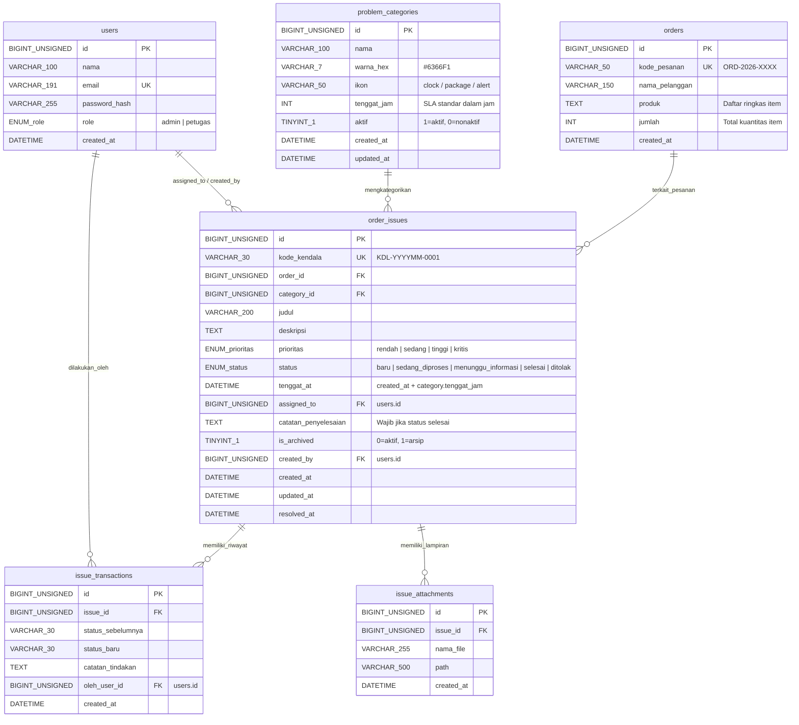
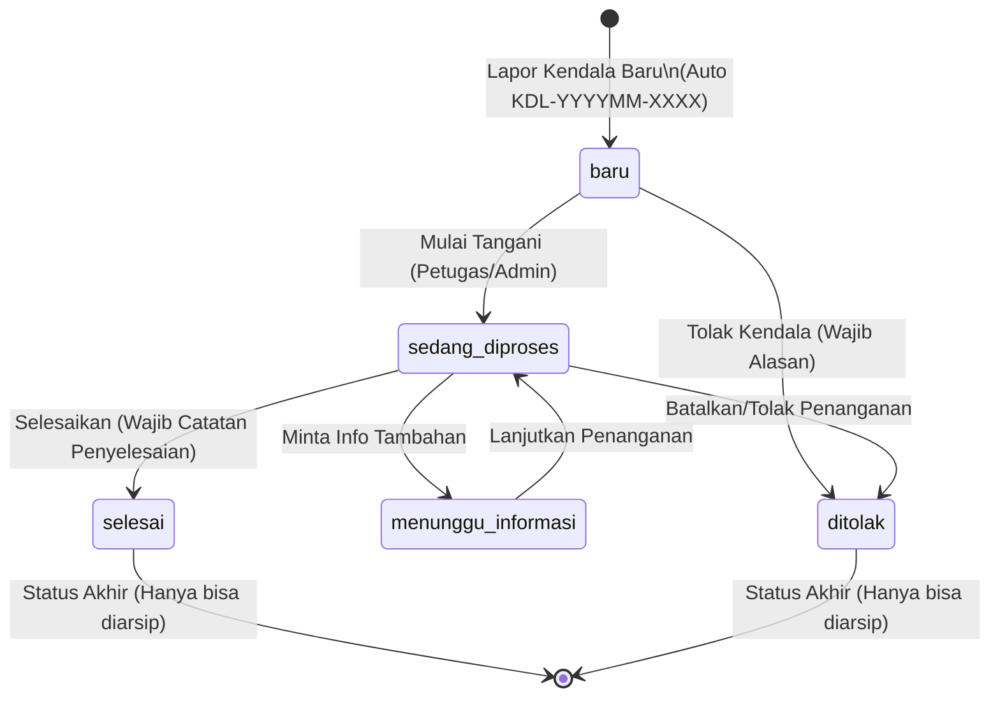

# KendalaKu - Arsitektur, Desain Sistem, & Rencana Implementasi

Aplikasi **KendalaKu** adalah *Sistem Manajemen Penanganan Kendala Pesanan* yang berfokus pada siklus pelaporan, tindak lanjut, delegasi petugas, pemantauan SLA (tenggat waktu), transaksi perubahan status, dan pelaporan metrik kendala pemrosesan pesanan.

---

## 1. Entity-Relationship Diagram (ERD)



### Indeks & Constraint Database:
- **Unique**: `users(email)`, `orders(kode_pesanan)`, `order_issues(kode_kendala)`
- **Composite/B-Tree Indexes**:
  - `idx_order_issues_status` (`status`)
  - `idx_order_issues_category` (`category_id`)
  - `idx_order_issues_assigned` (`assigned_to`)
  - `idx_order_issues_tenggat` (`tenggat_at`)
  - `idx_order_issues_created` (`created_at`)
  - `idx_issue_trans_issue` (`issue_id`)
- **Foreign Keys**:
  - `order_issues.order_id` -> `orders.id` (`ON DELETE RESTRICT`)
  - `order_issues.category_id` -> `problem_categories.id` (`ON DELETE RESTRICT`)
  - `order_issues.assigned_to` -> `users.id` (`ON DELETE RESTRICT`)
  - `order_issues.created_by` -> `users.id` (`ON DELETE RESTRICT`)
  - `issue_transactions.issue_id` -> `order_issues.id` (`ON DELETE CASCADE`)
  - `issue_transactions.oleh_user_id` -> `users.id` (`ON DELETE RESTRICT`)

---

## 2. Diagram State Transisi Kendala & Aturan Bisnis



### Validasi Transisi Status:
1. **baru** hanya boleh ke: `sedang_diproses` atau `ditolak`.
2. **sedang_diproses** hanya boleh ke: `menunggu_informasi`, `selesai`, atau `ditolak`.
3. **menunggu_informasi** hanya boleh ke: `sedang_diproses`.
4. **selesai** & **ditolak**: status akhir, tidak dapat ditransisikan kembali.
5. Transisi ilegal menghasilkan `HTTP 422 Unprocessable Entity` dengan rincian error deskriptif.
6. Transisi status dan penyimpanan `issue_transactions` dijalankan dalam satu DB Transaction (`BEGIN ... COMMIT`).
7. Pembuatan kode kendala unik berurutan bulanan (`KDL-YYYYMM-0001`) dikunci dengan transaksi `SELECT ... FOR UPDATE` agar aman terhadap race condition.

---

## 3. Design System KendalaKu (UI/UX)

Sistem desain KendalaKu memadukan kenyamanan kerja modern, aksen vibrant, dan kejelasan visual instan:

### A. Palet Warna (Color Palette)
- **Primary**: Deep Indigo (`#4F46E5`), Indigo Glow (`#6366F1`), Indigo Light (`#EEF2FF`)
- **Secondary / Accent**: Electric Teal (`#0D9488` / `#14B8A6`) & Warm Amber (`#F59E0B`)
- **Status Colors (Semantic)**:
  - **Baru**: Biru Elektrik (`#2563EB`, background `#EFF6FF`, Icon: `fiber_new_rounded`)
  - **Sedang Diproses**: Oranye Semangat (`#EA580C`, background `#FFF7ED`, Icon: `autorenew_rounded`)
  - **Menunggu Informasi**: Amber/Kuning Peringatan (`#D97706`, background `#FFFBEB`, Icon: `hourglass_top_rounded`)
  - **Selesai**: Hijau Segar (`#16A34A`, background `#F0FDF4`, Icon: `check_circle_rounded`)
  - **Ditolak**: Merah Mawar (`#DC2626`, background `#FEF2F2`, Icon: `cancel_rounded`)
- **Prioritas Indicator**:
  - **Rendah**: Slate Grey (`#64748B`, strip 4px abu-abu)
  - **Sedang**: Sky Blue (`#0284C7`, strip 4px biru)
  - **Tinggi**: Oranye Terang (`#D97706`, strip 4px oranye)
  - **Kritis**: Ruby Red (`#E11D48`, strip 4px merah berdenyut halus / pulse animation)
- **Dark Mode Palette**:
  - Surface: `#0F172A` (Slate 900), Card Surface: `#1E293B` (Slate 800), Accent: `#818CF8`, Border: `#334155`.

### B. Tipografi
- Font Family: **Google Fonts Plus Jakarta Sans** (bersih, humanis, kontemporer).
- Ukuran:
  - Display/Headline: 24-28sp Bold (Greeting, Card Total)
  - Title: 18-20sp SemiBold (Header bagian, Nama Kendala)
  - Body: 14-16sp Regular/Medium (Deskripsi kendala, label form)
  - Caption/Badge: 11-12sp SemiBold (Tag kategori, status chip, timestamp)

### C. Komponen & Interaksi Kunci
1. **Modern Header Card**:
   - Gradien lembut Indigo ke Violet (`LinearGradient(colors: [#4338CA, #6366F1])`).
   - Ilustrasi aksen blob dekoratif di latar belakang dengan opacity 15%.
   - Sapaan cerdas: *"Halo, Sonny! Ada 3 kendala perlu perhatian hari ini"*.
2. **Summary Metrics Cards**:
   - Kartu angka interaktif dengan animasi counter naik (`TweenAnimationBuilder`).
   - Indikator badge naik/turun dan ikon 3D/flat bernuansa pastel.
3. **Smart Issue Card**:
   - Border radius 20px, elevasi lembut dengan shadow berwarna tipis.
   - Strip prioritas di tepi kiri (warna kontras).
   - Swipe to action: geser kanan untuk update status cepat, geser kiri untuk opsi arsip/detail.
4. **Adaptive Navigation**:
   - Mobile: Floating-styled Bottom Navigation Bar + Quick Action FAB (+ Kendala).
   - Tablet / Desktop / Web: Side Navigation Rail / Drawer responsif dengan tampilan Master-Detail split-view.
5. **Multi-Step Issue Wizard (Stepper 3 Tahap)**:
   - Langkah 1: Pilih Pesanan Simulasi (dropdown pencarian debounce).
   - Langkah 2: Kategori & Deskripsi Kendala (chip visual kategori + textfield).
   - Langkah 3: Penugasan Petugas, Prioritas & Review SLA otomatis.

---

## 4. Struktur Monorepo

```text
kendalaku/
├── backend/
│   ├── cmd/
│   │   └── api/
│   │       └── main.go
│   ├── internal/
│   │   ├── config/             # Environment, database DSN, JWT secret
│   │   ├── domain/             # Struct entitas, DTO, interface repository/service
│   │   ├── handler/            # HTTP Controller (Gin), request binding, response format
│   │   ├── middleware/         # Auth JWT, CORS, Logger, Recovery
│   │   ├── repository/         # Raw SQL queries via sqlx
│   │   │   └── mysql/
│   │   └── service/            # Aturan bisnis, kalkulasi SLA, DB transaction transisi
│   ├── migrations/             # golang-migrate SQL (000001_init.up.sql & down.sql)
│   ├── pkg/
│   │   ├── database/           # Koneksi MySQL & sqlx pool
│   │   ├── hash/               # Bcrypt password hasher
│   │   ├── jwt/                # Token generator & claim parser
│   │   └── response/           # Format JSON konsisten {success, data, error}
│   ├── test/                   # Unit test aturan transisi status & integration
│   ├── .env.example
│   ├── Dockerfile
│   └── go.mod
├── mobile/
│   ├── lib/
│   │   ├── core/
│   │   │   ├── constants/      # App colors, styles, API endpoints
│   │   │   ├── network/        # Dio client, auth interceptor, error handler
│   │   │   ├── router/         # go_router configuration & route guards
│   │   │   ├── theme/          # ThemeData (light & dark theme)
│   │   │   └── utils/          # Date formatter, currency, helper
│   │   ├── data/
│   │   │   ├── models/         # Model data JSON serializable
│   │   │   └── repositories/   # Remote data source callers
│   │   ├── providers/          # Riverpod state providers
│   │   ├── views/
│   │   │   ├── auth/           # Login screen
│   │   │   ├── dashboard/      # Summary cards, fl_chart pie & bar charts
│   │   │   ├── issues/         # List, Filter Sheet, Stepper Form, Detail & Timeline
│   │   │   ├── reports/        # Recap table, CSV export dialog
│   │   │   └── categories/     # Master data category management
│   │   └── main.dart
│   ├── pubspec.yaml
│   └── README.md
├── docs/
│   ├── ARCHITECTURE.md         # Dokumen arsitektur, ERD, dan aturan sistem
│   ├── API_SPEC.md             # Dokumentasi REST API endpoint
│   └── DATABASE_SCHEMA.sql     # Skrip DDL referensi
├── docker-compose.yml          # MySQL 8 + Backend API (dengan healthcheck)
└── README.md                   # Petunjuk setup lengkap
```

---

## 5. Rencana Eksekusi Bertahap (Implementation Plan)

- **Fase 1: Rancangan & Spesifikasi Arsitektur** (Sedang Berjalan)
  - Penyusunan ERD Mermaid, spesifikasi status transition state-machine.
  - Penyiapan spesifikasi API dan Design System di folder `/docs`.
  - Review dan persetujuan pengguna sebelum lanjut menulis kode.
- **Fase 2: Backend Core, Database, Migrasi, Seed & Unit Test**
  - Setup `docker-compose.yml` (MySQL 8 + Go Backend).
  - Skrip migrasi database (golang-migrate) & Seeder realistis (6 kategori, 20 pesanan, 40 kendala dengan variasi tanggal 60 hari, 3 users).
  - Layer auth JWT, handler, service, sqlx repository untuk Categories & Issues (CRUD).
  - Implementasi atomic locking `SELECT ... FOR UPDATE` untuk kode kendala otomatis `KDL-YYYYMM-XXXX`.
  - Transaction status transition handler + issue_transactions insert.
  - Unit testing suite untuk memastikan aturan transisi status valid/tidak valid (HTTP 422).
- **Fase 3: Backend Lanjutan & Fitur Analitik**
  - Endpoint ringkasan dashboard, distribusi per kategori, tren kendala (7 hari/30 hari/12 bulan).
  - Endpoint rekapitulasi performa penanganan kendala & ekspor CSV stream.
- **Fase 4: Frontend Flutter - Fondasi, Auth, & Manajemen Kendala**
  - Inisialisasi Flutter project dengan Riverpod, go_router, dio, google_fonts.
  - Setup Design System (Plus Jakarta Sans, palet modern indigo, dark/light theme, custom buttons, custom chips).
  - Layar login, token storage, router auth guard.
  - Layar List Kendala (pencarian, chip filter, swipe-action, list beranimasi).
  - Layar Form Tambah Kendala (3-Step Wizard dengan auto SLA preview).
  - Layar Detail Kendala dengan timeline riwayat transaksi berwarna dan modal transisi status pintar.
- **Fase 5: Frontend Flutter - Dashboard Visual & Laporan**
  - Implementasi grafik fl_chart (Donut chart kendala per kategori, Bar/Line chart tren).
  - Kartu "Perlu Perhatian" (kendala lewat tenggat & kritis berdenyut).
  - Halaman Laporan, rekap waktu penyelesaian, dan trigger download file CSV.
  - Halaman Manajemen Kategori (CRUD dengan color picker & ikon).
- **Fase 6: Verifikasi End-to-End, Testing & Polish**
  - Verifikasi seluruh aliran transisi status, pengujian responsif mobile & desktop/web.
  - Uji seed data ulang idempotensi, kelengkapan .env.example, dan dokumentasi README.
- **Fase 7: Fitur Tambahan (Opsional)**
  - Upload lampiran bukti kendala / foto kendala.
